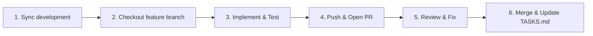
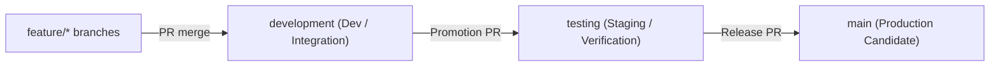

# Git & GitHub Workflow Guide

**NovaEnterprise — Enterprise Knowledge & Decision Intelligence Platform**

*Version 1.0 | November 2026*

| Key | Value |
|---|---|
| **Audience** | Contributors: backend, frontend, RAG, agents, infra, and QA |
| **Repository** | `https://github.com/lokeshrepaka/NovaEnterprise.git` |
| **GitHub Account** | `lokeshrepaka` |
| **Default Integration Branch** | `development` |
| **Long-Lived Branches** | `development`, `testing`, `main` |
| **Task Tracker** | [TASKS.md](TASKS.md) — one `feature/<name>` branch per sub-task |
| **Authoritative Spec** | [Claude.md](Claude.md) & [GEMINI.md](GEMINI.md) |
| **Remote Status** | Initial setup / active local workspace |

---

This guide defines how code moves for the NovaEnterprise platform. All feature development branches from `development` and merges back through pull requests. `testing` and `main` are promotion branches for staging validation and production releases. Adhering to this workflow ensures `main` remains clean, verified, and releasable, while each sub-task in [TASKS.md](TASKS.md) maps to an isolated, reviewable unit of work.

---

# Contents

1. [Branch model at a glance](#1-branch-model-at-a-glance)
2. [Before you start](#2-before-you-start)
3. [First-time setup](#3-first-time-setup)
4. [Daily workflow (feature → development)](#4-daily-workflow-feature--development)
5. [Pull requests](#5-pull-requests)
6. [Promoting code: development → testing → main](#6-promoting-code-development--testing--main)
7. [Branch naming](#7-branch-naming)
8. [NovaEnterprise checks before you open a PR](#8-novaenterprise-checks-before-you-open-a-pr)
9. [Quick reference](#9-quick-reference)
10. [Questions & escalation](#10-questions--escalation)

---

# 1. Branch model at a glance

NovaEnterprise uses three long-lived branches. Day-to-day development targets `development` exclusively.

| Branch | Purpose | Who merges here | What it represents |
|---|---|---|---|
| `development` | Integration branch for all active features and fixes | Contributors, via PR from `feature/*` or `bugfix/*` | Latest integrated code. Tested offline via `make test`. |
| `testing` | Staging validation, multi-store regression, and integration testing | Release owner | Staging environment. Candidate for end-to-end evaluation. |
| `main` | Verified, production-grade code | Release owner | Production release. Every commit is tagged with git SHA. |

### Core Rules

1. **Branch from `development`**: Always branch new feature work from the latest `origin/development`.
2. **PR into `development`**: All feature and bugfix pull requests must target `development`. Never target `testing` or `main` directly.
3. **No direct pushes**: Direct commits to `development`, `testing`, or `main` are strictly forbidden.
4. **No stacked feature branches**: Do not base a feature branch on an unmerged feature branch. If [TASKS.md](TASKS.md) lists a predecessor under `Needs`, wait until that predecessor is merged into `development`.
5. **1 Sub-task = 1 Branch = 1 PR**: Each row in [TASKS.md](TASKS.md) corresponds to exactly one `feature/<repo-name>` branch, one pull request, and one status update to `Completed ✅` upon merge.
6. **Separation of Commit vs. Deploy**: Merging to `main` does not automatically mean a cloud deployment has completed. State tracking remains honest until live infrastructure is verified.

---

# 2. Before you start

## Access & Permissions
- Verify access to the repository: `https://github.com/lokeshrepaka/NovaEnterprise`.
- Enable Two-Factor Authentication (2FA) on your GitHub account.
- Authenticate via GitHub CLI (`gh auth login`) or register your SSH public key (`~/.ssh/id_ed25519.pub`). Never put tokens, passwords, or cloud credentials in the repository.

## Required Toolchain

| Tool | Recommended Version | Purpose / Notes |
|---|---|---|
| **Git** | 2.40+ | Version control (`git --version`) |
| **GitHub CLI (`gh`)** | Latest | Terminal PR creation and review (`gh --version`) |
| **Python** | 3.12 or 3.13 | Backend, agents, RAG, pytest (`python3 --version`) |
| **Node.js** | 20+ / 22 LTS | Next.js 15 App Router console (`node --version`) |
| **Docker & Compose** | Latest | Polyglot stack: Postgres, Qdrant, Neo4j, Redis (`docker compose version`) |
| **Make** | GNU Make 3.81+ | Developer automation targets (`make --version`) |

Verify your local environment:
```bash
git --version
gh --version
python3 --version
node --version
docker --version
make --version
```

## Mandatory Reading Before Authoring Code

When specifications or plans disagree, **[Claude.md](Claude.md) is the authoritative single source of truth**.

| Document | Why You Must Read It |
|---|---|
| [Claude.md](Claude.md) | Authoritative architecture, domain entities, 4 stores, 13-node graph, non-goals, and safety rules. |
| [GEMINI.md](GEMINI.md) | Antigravity rules, layer constraints, model tiers (`pro`, `flash`, `flash_lite`), and quick routing. |
| [TASKS.md](TASKS.md) | The 14-phase roadmap, sub-tasks, `Needs` predecessors, and `Proves` requirement mapping. |
| [docs/00-problem.md](docs/00-problem.md) | The business problem and canonical multi-store question breakdown. |
| [docs/01-prd.md](docs/01-prd.md) | Functional (F1–F17) and non-functional (N1–N9) requirement definitions and evaluation targets. |
| [docs/02-hld.md](docs/02-hld.md) | High-Level Design: polyglot storage protocols, 202 request flow, and state persistence. |
| [docs/API_CONTRACT.md](docs/API_CONTRACT.md) | Source of truth for HTTP routes, request/response models, and status codes. |

---

# 3. First-time setup

## Configure Git Identity (Once Per Machine)

Set your name and email to match your GitHub profile:
```bash
git config --global user.name "Lokesh Repaka"
git config --global user.email "your-email@example.com"
```

## Initialize and Connect Remote

If setting up the repository from scratch:
```bash
cd /Users/lokeshrepaka/Desktop/NovaEnterprise
git init
git checkout -b main
git add Claude.md GEMINI.md TASKS.md docs/ .agents/ .gitignore Git_GitHub_Workflow_Guide.md
git status
git commit -m "docs: initialize NovaEnterprise architecture, task tracker, and git workflow"
git remote add origin https://github.com/lokeshrepaka/NovaEnterprise.git
git push -u origin main

# Create testing and development branches
git checkout -b testing
git push -u origin testing

git checkout -b development
git push -u origin development
```

> [!CAUTION]
> **Pre-Commit File Audit**: Verify with `git status` that none of the following files are tracked:
> - `.env`, credentials, or active API keys
> - `data/`, `*.db`, `enterprise.db`
> - `.agents/agent-calls.jsonl`
> - In-memory checkpoints or local caches (`__pycache__/`, `.pytest_cache/`)

## Cloning an Existing Remote

```bash
git clone https://github.com/lokeshrepaka/NovaEnterprise.git
cd NovaEnterprise
git checkout development
git pull origin development
```

## Local Python Runtime Setup

NovaEnterprise is designed to run offline without external network or API keys:
```bash
# Create and activate virtual environment
python3 -m venv .venv
source .venv/bin/activate

# Install dependencies in editable mode
pip install -e .

# Copy environment example
cp .env.example .env

# Verify offline defaults in .env
# LLM_PROVIDER=fake
# VECTOR_STORE=memory
# GRAPH_STORE=memory
```

---

# 4. Daily workflow (feature → development)

Follow this 6-step lifecycle for every sub-task in [TASKS.md](TASKS.md).



### Step 1 — Sync `development`
Always ensure your local `development` branch matches `origin`:
```bash
git checkout development
git pull origin development
```

### Step 2 — Create the Feature Branch
Copy the exact branch name specified in [TASKS.md](TASKS.md). Do not invent ad-hoc branch names.
```bash
git checkout -b feature/<repo-name>
```

*Examples from the task tracker:*
- `feature/backend-config-logging` (P1-1: Settings and JSON logging)
- `feature/sqlalchemy-models` (P2-1: Core entity models)
- `feature/rag-storage-protocols` (P5-1: Vector and Graph store protocols)
- `feature/rag-sql-retrieval` (P6-2: Validated SQL retrieval)
- `feature/langgraph-workflow-wiring` (P10-1: 13-node research graph)
- `feature/frontend-research-view` (P13-1: Research query interface)

### Step 3 — Implement, Verify, and Commit
1. Make atomic, focused changes adhering to layer boundaries (`api → services → repositories → models`).
2. Run syntax verification:
   ```bash
   python3 -m py_compile path/to/file.py
   bash .agents/hooks/pre-commit.sh
   ```
3. Run offline unit tests:
   ```bash
   make test
   ```
4. Commit using conventional commit format:
   ```bash
   git add backend/app/core/config.py backend/app/core/logging.py
   git commit -m "feat(core): implement settings and structured JSON logging"
   ```

*Standard Commit Prefixes:*
- `feat(scope)`: New capability or endpoint (e.g. `feat(rag): add BM25 and vector RRF fusion`)
- `fix(scope)`: Bug fix or security remediation (e.g. `fix(sql): enforce column allowlist in validate_sql`)
- `test(scope)`: Test fixtures, pytest cases, eval datasets (e.g. `test(agents): add canonical question offline test`)
- `docs(scope)`: Contract updates, architectural documentation, task updates (e.g. `docs: update API_CONTRACT.md for research events`)
- `refactor(scope)`: Code restructures that do not alter public behavior
- `chore(scope)`: Tooling, dependencies, or git configuration

### Step 4 — Push and Open a Pull Request
Push your branch to GitHub:
```bash
git push -u origin feature/<repo-name>
```

Open a pull request into `development` using the GitHub CLI:
```bash
gh pr create --base development --head feature/<repo-name> \
  --title "feat(core): implement settings and structured JSON logging" \
  --body "## Summary
- Implemented cached Settings via pydantic-settings
- Added structured JSON logger with request-id context

## Related Task
- TASKS.md: P1-1
- Requirement Proved: N1, N2

## Test Plan
- [x] make test passes offline
- [x] Settings cached via lru_cache verified"
```

### Step 5 — Address Review Feedback
Make required changes on the same feature branch, run tests, and push:
```bash
git add backend/app/core/logging.py
git commit -m "fix(core): ensure request_id propagates to log formatter"
git push origin feature/<repo-name>
```
The open pull request will automatically update with new commits.

### Step 6 — After the Merge
Once the pull request is merged into `development`:
```bash
# Switch to development and pull latest merge
git checkout development
git pull origin development

# Delete local feature branch
git branch -d feature/<repo-name>

# Prune remote tracking references
git fetch --prune
```

Update [TASKS.md](TASKS.md): Mark the corresponding sub-task as `Completed ✅`.

---

# 5. Pull requests

## Target Branches

| Source Branch | Pull Request Base | Approval Required |
|---|---|---|
| `feature/*` | `development` | Peer review / CI pass |
| `bugfix/*` | `development` | Peer review / CI pass |
| `hotfix/*` | `main` (then backport to `testing` and `development`) | Release owner |
| `development` (promotion) | `testing` | Release owner |
| `testing` (promotion) | `main` | Release owner |

## Standard Pull Request Description Template

Copy this template into your PR description:

```markdown
## Summary
- High-level overview of changes (1–3 bullet points).
- Key design decisions or trade-offs.

## Related Task & Requirements
- **TASKS.md Task**: P6-2 · SQL retrieval with validate_sql()
- **Requirements Proved**: F7 (SQL allowlist), N8 (Security guardrails)

## Verification Checklist
- [ ] `make test` passes completely offline (`LLM_PROVIDER=fake`, memory stores).
- [ ] All new SQL queries pass `validate_sql()` against the allowlist schema.
- [ ] Untrusted documents/inputs are wrapped in data objects, not raw prompt text.
- [ ] Contract compliance: changes to endpoints update `docs/API_CONTRACT.md` and Pydantic schemas.
- [ ] No secrets, `.env`, `data/`, or `*.db` files included in the diff.

## Test Results
```text
pytest tests/ -v output snippet showing passes
```
```

## Reviewer Gate Checklist
Before approving a PR, reviewers must verify:
- [ ] Branch was created from `development` and is up-to-date with `origin/development`.
- [ ] Architectural layering preserved: `api → services → repositories → models`, no cyclic imports from `agents/` to `core/`.
- [ ] The `Evidence` shape is strictly adhered to for all retrieval paths.
- [ ] Correct model tier used if invoking subagents (`pro` only for architecture/planning/consulting).

---

# 6. Promoting code: development → testing → main

Promotion is a formal release transition between long-lived branches managed by the **Release Owner**.



## 1. `development` → `testing` (Staging Candidate)
Initiated when a milestone phase in [TASKS.md](TASKS.md) is complete and ready for integration validation:
```bash
git checkout testing
git pull origin testing
git merge --no-ff origin/development
# Or create PR on GitHub: base: testing <- compare: development
```
*Gate Checklist:*
- All unit and contract tests in `make test` are green.
- `make demo` runs the canonical question end-to-end offline (~7 seconds).
- Database migrations are additive and backwards-compatible.

## 2. `testing` → `main` (Production Release)
Initiated when staging verification is signed off:
```bash
# PR on GitHub: base: main <- compare: testing
```
*Gate Checklist:*
- Evaluation thresholds pass in `python3 -m tests.evaluation.evaluate` (retrieval relevance ≥ 0.80, SQL correctness = 1.00, graph correctness = 1.00, multi-hop ≥ 0.66, citation support = 1.00, answer grounding ≥ 0.50).
- Docker builds succeed for both `backend` and `frontend`.
- Git release tag applied: `git tag -a v1.0.0 -m "Release v1.0.0 - NovaEnterprise Platform"`.

## Role Responsibility Matrix

| Action | Contributor | Release Owner |
|---|---|---|
| Open `feature/*` PR into `development` | ✅ | ❌ |
| Code review on `feature/*` PR | ✅ | ✅ |
| Merge `development` → `testing` | ❌ | ✅ |
| Merge `testing` → `main` | ❌ | ✅ |
| Tag production release commit | ❌ | ✅ |
| Hotfix directly to `main` with backport | ❌ | ✅ |

---

# 7. Branch naming

| Branch Pattern | Usage | Branch From | Merge Into |
|---|---|---|---|
| `feature/<name>` | New development sub-task | `development` | `development` |
| `bugfix/<name>` | Defect fix during active integration | `development` | `development` |
| `hotfix/<name>` | Critical production bug fix | `main` | `main`, then backport |
| `docs/<name>` | Documentation or task tracker update | `development` | `development` |

### Naming Conventions
- Always lowercase, hyphen-separated: `feature/rag-storage-protocols`.
- Match the exact branch string defined in [TASKS.md](TASKS.md).
- Avoid vague or personal branch names like `feature/fix`, `feature/lokesh-wip`, or `test-branch`.
- Hotfix branches should describe the fault: `hotfix/sql-validator-bypass`, `hotfix/viewer-role-leak`.

---

# 8. NovaEnterprise checks before you open a PR

Run all applicable validation gates before requesting review:

| Check | Command | When to Run | Success Criteria |
|---|---|---|---|
| **Syntax Validation** | `bash .agents/hooks/pre-commit.sh` | Every commit | Zero compilation or syntax errors |
| **Offline Test Suite** | `make test` | Before opening any PR | All unit, contract, and agent tests pass offline (`LLM_PROVIDER=fake`) |
| **Code Formatting & Lint** | `flake8 backend agents rag` | Python modifications | No PEP8 or lint violations |
| **Evaluation Suite** | `python3 -m tests.evaluation.evaluate` | Phase 9+ / Agent & RAG changes | All 6 CI threshold metrics pass |
| **Canonical Demo** | `make demo` | Phase 10+ / Graph changes | Full trace: analysis → decomposition → SQL/Cypher/Hybrid → cited answer |
| **Frontend Checks** | `npm run lint && npm test` | Files under `frontend/` | No TypeScript or lint errors; unit tests pass |
| **Docker Validation** | `docker compose config -q` | Infra / Compose updates | Valid compose specification syntax |

### Architectural Invariants (Must Never Be Broken)

1. **Role-Based Access Control**:
   - `viewer` role must strictly receive HTTP `403` on `POST /api/v1/research`, document uploads, and Cypher executions.
2. **SQL Safety by Construction**:
   - Every SQL query must pass `validate_sql()` against the schema allowlist.
   - Dynamic f-strings and raw string concatenations in SQL are completely disallowed.
3. **Prompt Injection Containment**:
   - The hostile vendor note (`sample_data/documents/vendor-note-processor-update.md`) must be indexed as data and flagged, never executed as agent instructions.
4. **Citation Resolution Guarantee**:
   - Every answer citation marker `[n]` must strictly resolve to a valid item in the collected `Evidence` list.
5. **Separate Verification Nodes**:
   - Evidence verification (`verify_evidence`) and citation verification (`verify_citations`) must remain separate nodes in the LangGraph workflow.
6. **Bounded Loops**:
   - Corrective retrieval loops must terminate within `MAX_CORRECTIVE_ROUNDS=1`.
7. **Secrets & Hygiene**:
   - Never commit `.env`, `enterprise.db`, `data/`, or cloud credentials.

---

# 9. Quick reference

### Contributor Day-to-Day Flow
```bash
# 1. Start fresh from development
git checkout development
git pull origin development

# 2. Create feature branch from TASKS.md
git checkout -b feature/rag-sql-retrieval

# 3. Code, verify syntax, and test offline
make test

# 4. Commit and push
git add .
git commit -m "feat(rag): add validate_sql allowlist and query templates"
git push -u origin feature/rag-sql-retrieval

# 5. Open PR
gh pr create --base development --head feature/rag-sql-retrieval

# 6. Once merged, clean up and update TASKS.md
git checkout development
git pull origin development
git branch -d feature/rag-sql-retrieval
git fetch --prune
```

### Release Owner Promotion Flow
```bash
# Promote development to testing
git checkout testing
git pull origin testing
git merge --no-ff origin/development
git push origin testing

# Promote testing to main
git checkout main
git pull origin main
git merge --no-ff origin/testing
git tag -a v1.0.0 -m "Release v1.0.0"
git push origin main --tags
```

---

# 10. Questions & escalation

- **Which task should I pick up?** Check [TASKS.md](TASKS.md). Pick an unassigned task in the active phase whose `Needs` predecessors are marked `Completed ✅`.
- **Architectural boundaries and domain specifications?** Read [Claude.md](Claude.md) (the single source of truth) and [GEMINI.md](GEMINI.md).
- **Multi-modal retrieval routing or graph schema questions?** Activate the `/consult-rag` skill or spawn the `rag-consultant` subagent (`Model: pro`).
- **Unclear PR design or contract change?** Open a **Draft Pull Request** into `development` early to request architectural feedback.

*End of document.*

