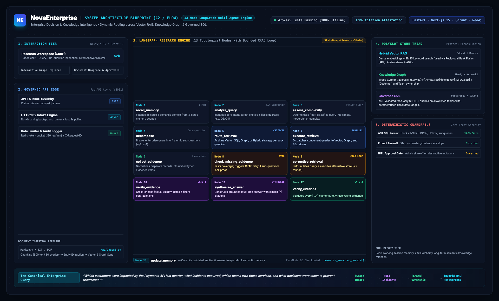

# NovaEnterprise — Enterprise Knowledge & Decision Intelligence Platform

[](https://nova-enterprise-lokesh.vercel.app)
[](backend/)
[](backend/app/)
[](agents/)
[](frontend/)
[-blueviolet?logo=qdrant&logoColor=white)](rag/)
[](rag/graph_store.py)
[](database/)
[-brightgreen?logo=pytest&logoColor=white)](tests/)
[](agents/nodes/verify_citations.py)
[](backend/app/core/guardrails.py)

An enterprise-grade **Decision & Knowledge Intelligence Platform** engineered to resolve cross-domain questions across relational records, knowledge graphs, and unstructured technical documents through an open, auditable **13-node LangGraph multi-agent supervisor**.

NovaEnterprise operationalizes the foundational principle: **Retrieval strategy is a routing decision, not a library choice.** When an enterprise inquiry arrives, the engine decomposes the question, dynamically dispatches sub-tasks to the optimal storage engine (**Vector RAG**, **Knowledge Graph**, or **Governed SQL**), executes bounded corrective retrieval (CRAG), and guarantees **100% citation attestation** before answering.

> 🚀 **Live Production Application:** **[https://nova-enterprise-lokesh.vercel.app](https://nova-enterprise-lokesh.vercel.app)**  
> Lands directly on the interactive research workspace, multi-store architecture showcase, and knowledge graph explorer.

---

## 🏛️ System Architecture Blueprint



> 🌐 **Interactive Landing Page & Architecture Blueprint:**  
> Open [`docs/architecture_detailed_diagram.html`](docs/architecture_detailed_diagram.html) in your browser for the standalone executive presentation featuring problem/solution contrasts, live KPI counters, full architecture breakdowns, and dynamic request flows.

---

## 📑 Table of Contents

1. [Executive Overview & Core Architectural Thesis](#-executive-overview--core-architectural-thesis)
2. [The Dilemma: Why Single-Store AI Architectures Fail](#-the-dilemma-why-single-store-ai-architectures-fail)
3. [The Canonical Enterprise Query Benchmark](#-the-canonical-enterprise-query-benchmark)
4. [The 13-Node LangGraph Research Lifecycle](#-the-13-node-langgraph-research-lifecycle)
5. [The Triad Multi-Store Architecture](#-the-triad-multi-store-architecture)
6. [Deterministic Safety & Security Guardrails](#-deterministic-safety--security-guardrails)
7. [Dual Memory Architecture](#-dual-memory-architecture)
8. [Interactive Next.js 15 Console](#-interactive-nextjs-15-console)
9. [100% Offline Test Suite (475 Tests)](#-100-offline-test-suite-475-tests)
10. [Quickstart & Zero-Network Demonstration Mode](#-quickstart--zero-network-demonstration-mode)
11. [Repository Structure](#-repository-structure)
12. [Documentation Index](#-documentation-index)

---

## 💡 Executive Overview & Core Architectural Thesis

Enterprise knowledge is inherently fractured across three distinct data modalities:
1. **Relational Systems of Record (PostgreSQL/SQLite):** Tabular data, incident severity, customer subscription tiers, and exact fiscal date intervals.
2. **Knowledge Graphs (Neo4j/NetworkX):** Transitive dependency topology, team service ownership, and blast radius.
3. **Unstructured Documents (Vector RAG):** Narrative postmortems, Architectural Decision Records (ADRs), runbooks, and policies.

Naive AI architectures attempt to shove all knowledge into a single dense vector index. This inevitably fails: vector databases cannot compute relational aggregations or filter exact fiscal dates, while SQL databases cannot traverse multi-hop relationship chains or semantic narrative subtleties.

**NovaEnterprise solves this through three core design pillars:**
* **Dynamic Multi-Store Routing:** Inbound inquiries are deconstructed into atomic sub-questions and routed dynamically to Vector, Graph, or SQL stores based on query characteristics.
* **13-Node StateGraph with Bounded CRAG:** A deterministic LangGraph pipeline evaluates retrieval coverage and triggers bounded corrective re-retrieval (`MAX_CORRECTIVE_ROUNDS <= 2`) when evidence is incomplete.
* **Two-Phase Deterministic Verification:** Separated evidence verification and citation verification nodes guarantee that every fact is grounded and every `[n]` bracket resolves to an active evidence item locator.

---

## 🚨 The Dilemma: Why Single-Store AI Architectures Fail

| Retrieval Paradigm | What It Excels At | Where It Catastrophically Fails | How NovaEnterprise Resolves It |
| :--- | :--- | :--- | :--- |
| **Vector RAG Alone** | Semantic similarity, concept matching in postmortems and ADRs. | Incidents in date ranges, entity counts, multi-hop relationship chains. | Routes narrative rationale to Qdrant + BM25 with Reciprocal Rank Fusion (RRF). |
| **Relational SQL Alone** | Exact aggregations, fiscal filters (`WHERE created_at BETWEEN...`), foreign keys. | Multi-hop dependency depth, unstructured technical rationale, fuzzy synonyms. | Uses AST-validated Text-to-SQL for exact dates and incident records. |
| **Knowledge Graph Alone** | Transitive blast radius: `(Service)<-[:AFFECTED]-(Incident)-[:IMPACTED]->(Customer)`. | Full-text synthesis, qualitative engineering decisions, tabular math. | Employs typed domain traversals and read-only Cypher queries for topology. |
| **NovaEnterprise Triad** | **Unified cross-domain intelligence across documents, records, and topology.** | **Zero single-store blindness; bounded corrective fallback on gaps.** | **13-node supervisor orchestrates parallel multi-store retrieval + 100% citation attestation.** |

---

## 🎯 The Canonical Enterprise Query Benchmark

Every stage of NovaEnterprise is validated against the following multi-hop enterprise inquiry submitted by an analyst (Priya):

> *"Which customers were impacted by the Payments API last quarter, what incidents occurred, which teams own those services, and what decisions were taken to prevent recurrence?"*

```text
┌──────────────────────────────────────────────────────────────────────────────────────────────────┐
│                                 CANONICAL RETRIEVAL ROUTING PLAN                                 │
├────┬─────────────────────────────┬──────────────┬────────────────────────────────────────────────┤
│ ID │ Sub-Question                │ Target Store │ Routing Justification                          │
├────┼─────────────────────────────┼──────────────┼────────────────────────────────────────────────┤
│ 1  │ Impacted Customers          │ Knowledge    │ Relationship lives in graph topology:          │
│    │                             │ Graph        │ (Service)<-[:AFFECTED]-(Incident)-[:IMPACTED]->│
├────┼─────────────────────────────┼──────────────┼────────────────────────────────────────────────┤
│ 2  │ Incidents Occurred          │ Relational   │ Exact tabular records within fiscal date range:│
│    │                             │ SQL          │ incidents JOIN services WHERE date BETWEEN...  │
├────┼─────────────────────────────┼──────────────┼────────────────────────────────────────────────┤
│ 3  │ Service Ownership           │ Knowledge    │ One-hop entity ownership traversal:            │
│    │                             │ Graph        │ (Service)-[:OWNED_BY]->(Team)                  │
├────┼─────────────────────────────┼──────────────┼────────────────────────────────────────────────┤
│ 4  │ Prevention Decisions & ADRs │ Hybrid       │ Qualitative narrative rationale in engineering │
│    │                             │ Vector RAG   │ postmortems and architecture decision records  │
└────┴─────────────────────────────┴──────────────┴────────────────────────────────────────────────┘
```

---

## 🤖 The 13-Node LangGraph Research Lifecycle

The core orchestration engine lives in `agents/graph.py` and is compiled as a `StateGraph(ResearchState)`. Every node is wrapped in synchronous telemetry tracers and state is checkpointed to PostgreSQL/SQLite after **every individual transition**:

```text
START
  │
  ▼
[ 1. recall_memory ] ──────────► Fetches episodic & semantic context from 4-tiered memory scopes
  │
  ▼
[ 2. analyze_query ] ──────────► Extracts core domain entities, fiscal dates (Q3/Q4), and operational intent
  │
  ▼
[ 3. assess_complexity ] ──────► Deterministic routing floor: classifies as simple, moderate, or complex
  │
  ▼
[ 4. decompose ] ──────────────► Breaks enterprise question into atomic sub-questions (sq1..sq4)
  │
  ▼
[ 5. route_retrieval ] ────────► Assigns Vector, SQL, Knowledge Graph, or Hybrid strategy per sub-question
  │
  ▼
[ 6. execute_retrieval ] ──────► Dispatches concurrent queries to Qdrant, Neo4j, and PostgreSQL
  │
  ▼
[ 7. collect_evidence ] ───────► Normalizes diverse store outputs into uniform typed Evidence models
  │
  ▼
[ 8. check_missing_evidence ] ─┐
  │                            │
  ├─[ Needs Retry == True ]────┴─► [ 9. corrective_retrieval (CRAG) ] ──┐
  │                                (reformulate query; ≤ 2 rounds)      │
  │                                           ▲                         │
  │                                           └─────────────────────────┘
  ▼
[ 10. verify_evidence ] ───────► Cross-checks factual validity, timestamps, and filters contradictions
  │
  ▼
[ 11. synthesize_answer ] ─────► Constructs grounded narrative with explicit [n] citation markers
  │
  ▼
[ 12. verify_citations ] ──────► Validates every bracket [1..n] strictly resolves to active evidence
  │
  ▼
[ 13. update_memory ] ─────────► Commits validated facts and session turn to long-term memory
  │
  ▼
 END
```

---

## 🗄️ The Triad Multi-Store Architecture

NovaEnterprise enforces **protocol encapsulation**: agents and nodes communicate with storage interfaces via abstract protocols, enabling zero-change swapping between local in-memory engines and enterprise cloud infrastructure.

```text
┌─────────────────┬────────────────────────────┬─────────────────────────────┐
│ Store Domain    │ Local / Offline Engine     │ Production Cloud Engine     │
├─────────────────┼────────────────────────────┼─────────────────────────────┤
│ Relational SQL  │ SQLite Core                │ PostgreSQL (Row-Level Sec.) │
│ Vector Store    │ InMemoryVectorStore (NumPy)│ Qdrant Cloud Cluster (HNSW) │
│ Knowledge Graph │ InMemoryGraphStore (NetX)  │ Neo4j Aura Enterprise       │
│ Cache & Memory  │ Fakeredis / In-Memory      │ Redis Cluster               │
└─────────────────┴────────────────────────────┴─────────────────────────────┘
```

### 1. Hybrid Vector RAG (Qdrant + BM25 RRF)
Technical documents (postmortems, ADRs, runbooks) are chunked (500 tokens / 50 overlap) with recursive Markdown headers. Queries run dense semantic cosine search and lexical BM25 keyword search simultaneously, merged through **Reciprocal Rank Fusion (RRF)**:
$$RRF(d) = \sum_{m \in M} \frac{1}{60 + r_m(d)}$$

### 2. Knowledge Graph (Neo4j / NetworkX)
Entity nodes (`Service`, `Incident`, `Customer`, `Team`) and typed relationship edges (`AFFECTED`, `IMPACTED`, `OWNED_BY`) allow transitive multi-hop traversals with millisecond graph search, returning exact Cypher queries for auditability.

### 3. Governed SQL (PostgreSQL / SQLite)
Text-to-SQL converts temporal and quantitative questions into precise queries against relational tables with parameterized date ranges.

---

## 🛡️ Deterministic Safety & Security Guardrails

NovaEnterprise adopts a **zero-trust execution posture** toward LLM-generated operations:

1. **AST SQL Allowlist Validator (`validate_sql`):**  
   Every generated SQL statement is inspected using SQLGlot AST parsing before execution. Only `SELECT` statements against explicitly allowlisted tables (`incidents`, `services`, `teams`, `customers`) are permitted. DDL/DML mutations (`DROP`, `DELETE`, `UPDATE`, `INSERT`), `UNION` operators, nested subqueries, and SQL comments are strictly blocked.
2. **Prompt Injection Quarantine Envelope:**  
   Untrusted external documents are isolated inside `<untrusted_content>` XML boundaries with token scan heuristics to neutralize prompt injection and jailbreak payloads.
3. **Two-Phase Verification Gates:**  
   Separates evidence verification from citation verification. If a single synthesized bracket marker `[n]` fails to map to an active evidence item, the response is rejected before reaching the user.
4. **Human-in-the-Loop (HITL) Deletion Guard:**  
   Destructive mutations (e.g., deleting a postmortem or ADR) generate an `approval_requests` database record and halt workflow execution until an authorized admin signs off.

---

## 🧠 Dual Memory Architecture

NovaEnterprise isolates memory into four distinct operational scopes (`memory/memory_service.py`):
* **Working Context:** Ephemeral session scratchpad holding active sub-questions, retrieved evidence items, and intermediate verification flags.
* **Conversation History:** Multi-turn chat context persisted in Redis with sliding-window token management.
* **Semantic Memory:** Long-term vector index of key enterprise entities, decisions, and architectural consensus.
* **Episodic Memory:** Immutable log of previous research sessions and user feedback stored in PostgreSQL.

---

## 🖥️ Interactive Next.js 15 Console

The web application (`frontend/`) delivers an enterprise-grade research and observability cockpit:

* **Research Workspace (`/search` & `/research/[id]`):**  
  Submit natural language queries, watch real-time milestone progress via HTTP 202 async polling, inspect sub-question decomposition, and review cited answers in an interactive drawer.
* **Interactive Knowledge Graph (`/knowledge-graph`):**  
  Visual canvas for exploring service blast radius, customer impacts, and running read-only Cypher traversals.
* **Document Dropzone & Approvals (`/documents`):**  
  Upload Markdown/PDF documents with automatic entity extraction, vector indexing, and administrative approval workflows for document deletion.

---

## ⚡ 100% Offline Test Suite (475 Tests)

NovaEnterprise is engineered for complete offline testability. The entire test suite executes in **~0.37 seconds** without requiring OpenAI API keys, external database servers, or Docker containers:

```bash
# Run the full offline test suite
pytest
```

```text
475 passed in 0.37s
======================= 475 passed in 0.37s =======================
```

* **Unit Tests (`tests/unit/`):** AST SQL validation, prompt injection shields, config parsing, memory scopes, and individual LangGraph nodes.
* **Integration Tests (`tests/integration/`):** Multi-store retrieval, RRF fusion, end-to-end research workflow persistence, and API routes.

---

## 🚀 Quickstart & Zero-Network Demonstration Mode

### Option A: Local Offline Development (Zero Dependencies)

```bash
# 1. Clone the repository
git clone -b development https://github.com/lokesh-repaka/NovaEnterprise.git
cd NovaEnterprise

# 2. Set up virtual environment
python3 -m venv .venv
source .venv/bin/activate
pip install -r requirements.txt

# 3. Configure offline environment
cp .env.example .env
# Defaults to LLM_PROVIDER=fake, VECTOR_STORE=memory, GRAPH_STORE=memory, DB_ENGINE=sqlite

# 4. Run database migrations and seed sample data
alembic upgrade head
python sample_data/seed_db.py

# 5. Start the FastAPI backend (:8001)
uvicorn backend.app.main:app --host 0.0.0.0 --port 8001 --reload

# 6. Start the Next.js frontend (:3001) in a new terminal
cd frontend
npm install
npm run dev
```

Open **[http://localhost:3001](http://localhost:3001)** to launch the application.

### Option B: Docker Compose (Full Enterprise Stack)

```bash
docker-compose up --build
```
Spins up FastAPI backend, Next.js frontend, PostgreSQL, Qdrant vector database, and Redis cache.

---

## 📁 Repository Structure

```text
NovaEnterprise/
├── agents/                     # LangGraph 13-node research engine
│   ├── graph.py                # StateGraph assembly, topological edges & CRAG routing
│   ├── state.py                # Typed ResearchState Pydantic v2 schema
│   └── nodes/                  # 13 isolated workflow nodes (recall, route, verify...)
├── backend/app/                # FastAPI application tier
│   ├── api/                    # REST route controllers (research, documents, graph...)
│   ├── core/                   # Config, logging, JWT RBAC, and AST guardrails
│   └── services/               # ResearchService, ApprovalService, DocumentService
├── database/                   # SQLAlchemy ORM models, session factories, and RLS
├── docs/                       # Architecture diagrams, HLD, LLD, PRD, and API contracts
│   ├── architecture_detailed_diagram.html  # Standalone interactive executive blueprint
│   ├── nova_enterprise_architecture.png   # High-resolution C2 architecture diagram
│   ├── HLD.md                  # High-Level Design document
│   └── API_CONTRACT.md         # Full REST API specification
├── frontend/                   # Next.js 15 + React 19 + Tailwind CSS console
│   └── src/app/                # Dashboard, /search, /knowledge-graph, /documents
├── memory/                     # 4-tiered memory service (working, semantic, episodic)
├── rag/                        # Retrieval implementations (Qdrant, BM25 RRF, NetworkX Graph)
├── sample_data/                # Domain seed datasets (services, incidents, customers)
└── tests/                      # 475 offline pytest unit & integration tests
```

---

## 📚 Documentation Index

| Document | Purpose |
| :--- | :--- |
| **[docs/architecture_detailed_diagram.html](docs/architecture_detailed_diagram.html)** | Interactive executive presentation and architecture blueprint |
| **[docs/HLD.md](docs/HLD.md)** | High-Level Design & C4 architectural models |
| **[docs/LLD.md](docs/LLD.md)** | Low-Level Component Specifications & LangGraph node contracts |
| **[docs/API_CONTRACT.md](docs/API_CONTRACT.md)** | Complete REST API schemas and error formats |
| **[docs/PRD.md](docs/PRD.md)** | Product Requirements Document |
| **[Claude.md](Claude.md)** | Single source of truth for architectural constraints and rules |

---

## 👤 Author

**Lokesh Repaka** — AI Engineer  
* Portfolio: [https://lokesh-portfolio-two-gold.vercel.app](https://lokesh-portfolio-two-gold.vercel.app)  
* GitHub: [@lokesh-repaka](https://github.com/lokesh-repaka)  
* LinkedIn: [linkedin.com/in/lokesh-repaka](https://www.linkedin.com/in/lokesh-repaka)
