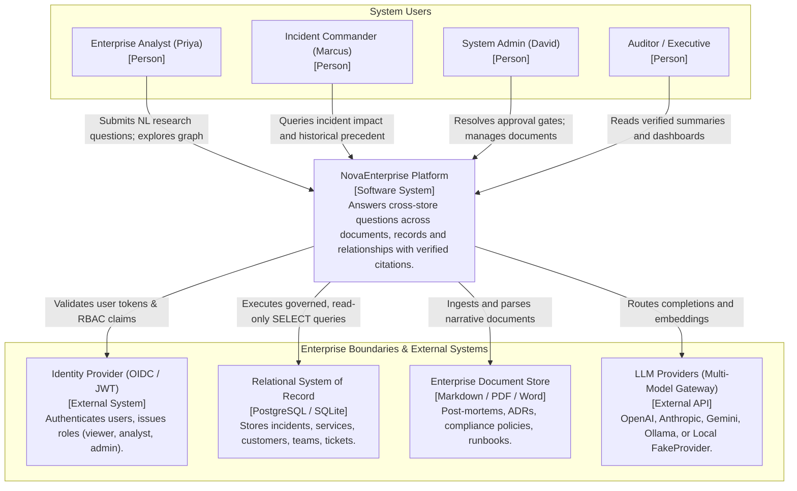
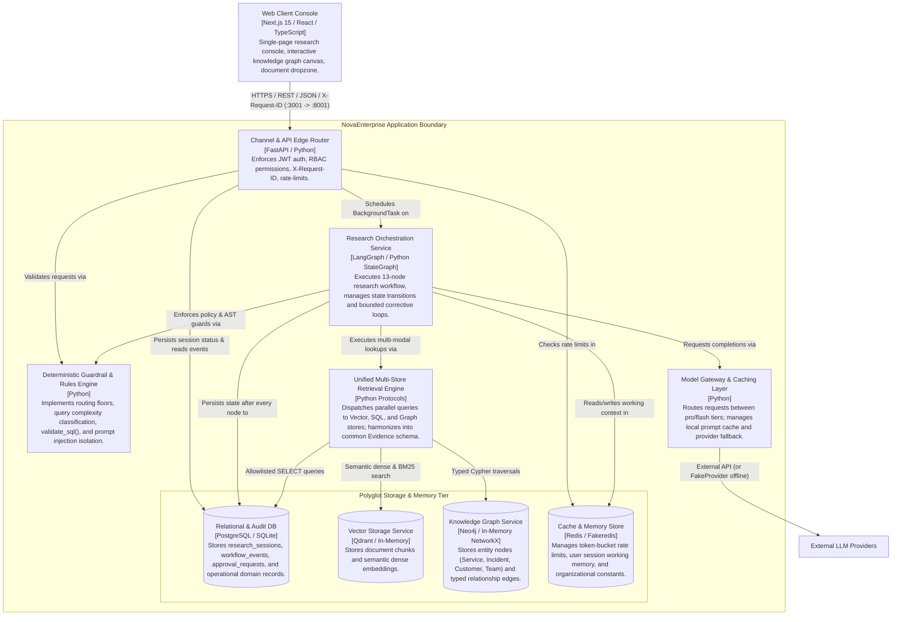
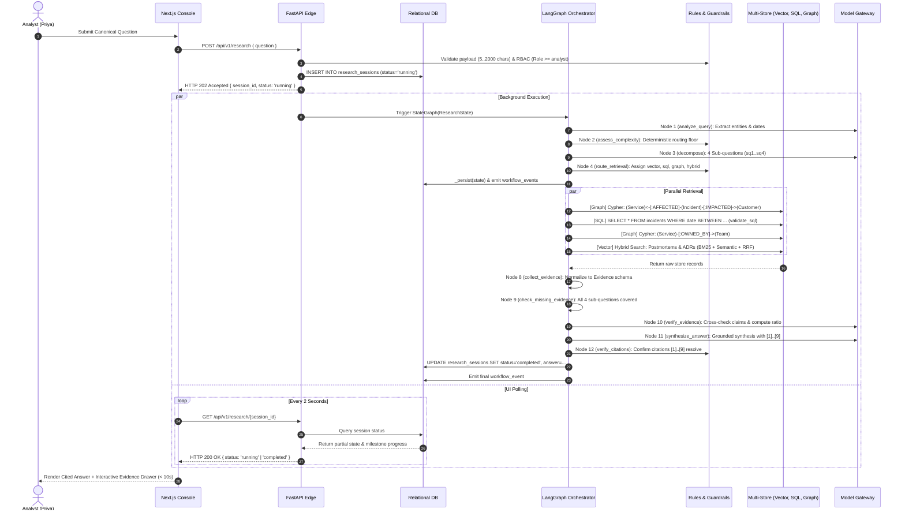

# High-Level Design (HLD)
## NovaEnterprise — Enterprise Knowledge & Decision Intelligence Platform

> **Document Status:** Approved / Baseline  
> **Author:** Enterprise AI Solution Architect  
> **Target Audience:** Engineering Leads, System Architects, DevOps/SRE, Enterprise Security, Technical Product Managers  
> **Methodology Reference:** *The Complete AI Solution Architect Masterclass (NITMONK 2026)* — System Views: C1 Context → C2 Containers → Dynamic Flows  
> **Upstream Documents:** [docs/BRD.md](BRD.md) (Business Requirements) · [docs/PRD.md](PRD.md) (Product Requirements) · [docs/FRD.md](FRD.md) (Functional Requirements)  
> **Downstream Documents:** [docs/LLD.md](LLD.md) (Low-Level Design & Component Specifications) · [Claude.md](../Claude.md) (System Specification)

---

## 1. Purpose, Scope & Business Context

### 1.1 Purpose
This High-Level Design (HLD) defines the structural architecture, subsystem decomposition, container topology, data architectures, and integration interfaces for **NovaEnterprise**. It answers: **what are the major parts of the system, and how do they fit and communicate together?**

### 1.2 System Scope
NovaEnterprise bridges structured operational records (Relational SQL), entity dependency topologies (Knowledge Graph), and unstructured narratives (Vector RAG) through a governed multi-agent supervisor. It provides:
- A non-blocking asynchronous research API.
- A 13-node state-persisted LangGraph orchestration engine.
- Replaceable polyglot storage protocols (In-Memory for zero-dependency offline local testability; Managed Cloud for production).
- Strict deterministic guardrails guaranteeing 100% citation resolution, SQL safety, and prompt injection neutralization.

---

## 2. Architecture Drivers & Trade-Offs

Following **Slide 8 of the AI Solution Architect Masterclass**, every architecture choice represents an intentional trade-off across the six core AI architecture drivers:

```text
┌────────────────────────────────────────────────────────────────────────┐
│                   AI ARCHITECTURE DRIVER TRADE-OFFS                    │
├───────────────┬──────────────┬─────────────────────────────────────────┤
│ Driver        │ Target Metric│ Architectural Trade-Off Decision        │
├───────────────┼──────────────┼─────────────────────────────────────────┤
│ Accuracy      │ 1.00 Citation│ Gained by: Adding two separate          │
│               │ Support;     │ verification nodes (evidence & citation)│
│               │ 1.00 SQL &   │ and Reciprocal Rank Fusion.             │
│               │ Graph Corr.  │ Sacrificed: ~1.5s additional compute.   │
├───────────────┼──────────────┼─────────────────────────────────────────┤
│ Safety        │ 0 Injection  │ Gained by: Quarantining all external    │
│               │ Exploits;    │ documents as XML data envelopes and AST │
│               │ 0 Raw SQL    │ allowlist parsing (validate_sql).       │
│               │              │ Sacrificed: Disallowed arbitrary user   │
│               │              │ SQL and ad-hoc free-form agent queries. │
├───────────────┼──────────────┼─────────────────────────────────────────┤
│ Latency       │ < 10s Total  │ Gained by: 202 Async intake flow with   │
│               │ Canonical Run│ fast polling; parallel store retrieval; │
│               │ (< 500ms 202)│ fast-path routing for simple queries.   │
├───────────────┼──────────────┼─────────────────────────────────────────┤
│ Cost          │ < $0.05 per  │ Gained by: Model Gateway tiering        │
│               │ Complex Run  │ (flash/flash_lite for 80% tasks; pro    │
│               │              │ reserved for planning); prompt caching. │
├───────────────┼──────────────┼─────────────────────────────────────────┤
│ Scalability   │ 120 req/min; │ Gained by: Stateless FastAPI web tier;  │
│               │ 100+ active  │ Redis token-bucket rate limiting;       │
│               │ sessions     │ polyglot decoupled databases.           │
├───────────────┼──────────────┼─────────────────────────────────────────┤
│ Observability │ 100% Node    │ Gained by: Synchronous tracer wrapping  │
│               │ Traceability │ on every node persisting to DB.         │
│               │              │ Sacrificed: Shielded raw internal chains│
│               │              │ of thought to preserve prompt privacy.  │
└───────────────┴──────────────┴─────────────────────────────────────────┘
```

---

## 3. C4 Architecture Views

### 3.1 C1: System Context Diagram (Slide 10 Alignment)
The C1 diagram shows NovaEnterprise as one software system bounded by its users and neighboring enterprise systems:



---

### 3.2 C2: Container Diagram (Slide 11 Alignment)
The C2 diagram zooms inside the NovaEnterprise platform boundary, showing the deployable, runnable containers and storage components:



---

## 4. Key Dynamic Sequence Flows

### 4.1 Canonical Research Workflow Sequence (End-to-End Dynamic Execution)



---

## 5. Polyglot Data Architecture & Storage Contracts

The foundational architectural principle of NovaEnterprise is **storage encapsulation behind protocol contracts**. No agent or routing node communicates directly with underlying database drivers.

```text
┌────────────────────────────────────────────────────────────────────────┐
│                        POLYGLOT STORAGE TOPOLOGY                       │
├───────────────┬────────────────────────────┬───────────────────────────┤
│ Store Domain  │ Local / Offline Adapter    │ Cloud / Production Adapter│
├───────────────┼────────────────────────────┼───────────────────────────┤
│ Relational DB │ SQLite Core (enterprise.db)│ Supabase / PostgreSQL     │
│               │ (SQLAlchemy ORM)           │ (Row-Level Security [RLS])│
├───────────────┼────────────────────────────┼───────────────────────────┤
│ Vector Store  │ InMemoryVectorStore        │ Qdrant Cloud Cluster      │
│               │ (NumPy cosine similarity)  │ (HNSW collection index)   │
├───────────────┼────────────────────────────┼───────────────────────────┤
│ Graph Store   │ InMemoryGraphStore         │ Neo4j Aura Enterprise     │
│               │ (NetworkX digraph)         │ (Bolt protocol over TLS)  │
├───────────────┼────────────────────────────┼───────────────────────────┤
│ Epistemic     │ Fakeredis in-memory mock   │ Redis Cluster (v7.2+)     │
│ Cache & Memory│                            │ (AOF persistence)         │
└───────────────┴────────────────────────────┴───────────────────────────┘
```

### 5.1 Storage Protocol Contracts
- **`VectorStoreService` (`rag/vector_store.py`):**
  - `add_documents(documents: list[Chunk]) -> None`
  - `similarity_search(query_vector: list[float], k: int = 10, filters: dict = None) -> list[Chunk]`
- **`GraphStoreService` (`rag/graph_store.py`):**
  - `execute_traversal(traversal_type: str, params: dict) -> list[GraphRecord]`
  - `query_read_only(cypher: str, params: dict) -> list[dict]`

---

## 6. Deployment View & Network Topologies (Slide 20 Alignment)

NovaEnterprise enforces clear network zoning following enterprise defense-in-depth principles:

```text
                                  PUBLIC INTERNET
                                         │
═════════════════════════════════════════╪═══════════════════════════════════════
NORTH-SOUTH PERIMETER (DMZ)              ▼
                           ┌───────────────────────────┐
                           │   Cloudflare WAF / DDoS   │
                           │     TLS 1.3 Termination   │
                           └─────────────┬─────────────┘
                                         │
                           ┌─────────────▼─────────────┐
                           │   Next.js 15 Web Console  │
                           │   Public Subnet (:3001)   │
                           └─────────────┬─────────────┘
═════════════════════════════════════════╪═══════════════════════════════════════
EAST-WEST BOUNDARY (Private App Subnet)  ▼
                           ┌───────────────────────────┐
                           │   FastAPI Core Services   │
                           │  LangGraph Orchestration  │
                           │     Port 8001 (mTLS)      │
                           └──────┬──────┬──────┬──────┘
                                  │      │      │
══════════════════════════════════╪══════╪══════╪════════════════════════════════
ISOLATED DATA SUBNET (Private)    ▼      ▼      ▼
                        ┌───────────┐ ┌──────┐ ┌──────────┐ ┌──────────┐
                        │PostgreSQL │ │Qdrant│ │  Neo4j   │ │  Redis   │
                        │Relational │ │Vector│ │  Graph   │ │  Cache   │
                        └───────────┘ └──────┘ └──────────┘ └──────────┘
```

- **North-South Traffic:** Web ingress passes through WAF, enforcing IP rate limits and TLS termination. Static assets are served via Edge CDN.
- **East-West Traffic:** Communication between Next.js and FastAPI uses tokenized headers (`Authorization: Bearer <JWT>`, `X-Request-ID`). Internal microservices operate in private VPC subnets with non-routable private IPs.
- **Data Subnet Egress:** Database engines reside in completely isolated private subnets with no public internet gateways. Outbound LLM provider calls route strictly through an egress NAT gateway.

---

## 7. Security, Availability & Disaster Recovery Approach

### 7.1 Defense-in-Depth Security Architecture (Slide 22 Alignment)
1. **Quarantined Document Ingestion:** All ingested files (PDF/MD/TXT) are wrapped in immutable `<untrusted_document_data>` containers. The injection scanner intercepts known heuristic patterns (e.g., prompt leakage, instruction override) and marks files with `flagged_injection=True`.
2. **SQL Safety AST Allowlist (`validate_sql()`):** The SQL agent does not execute raw strings. Generated queries are parsed into Abstract Syntax Trees (ASTs). The validator strictly asserts:
   - Command is a read-only `SELECT`.
   - All referenced tables exist in `{"incidents", "services", "teams", "customers", "decisions"}`.
   - Disallows union attacks, system functions, and semicolon chaining.
3. **Cypher Safety:** User-initiated Cypher queries pass through regular expression and keyword tokenizers that strip write operators (`CREATE`, `MERGE`, `DELETE`, `SET`, `DROP`).
4. **Secrets Hygiene:** Zero credentials in source code. Local execution uses `.env` (git-ignored); production deployments utilize HashiCorp Vault or AWS Secrets Manager.

### 7.2 Availability & Graceful Degradation Approach
- **Resilient Multi-Store Execution:** The platform is architected so that if an individual storage service (e.g., Neo4j) fails, the entire workflow **does not crash**. The retrieval node captures the connection exception, records an explicit error in `ResearchState.errors`, and completes retrieval across the operational stores.
- **Comprehensive Health Checks (`/health/ready`):**
  - Evaluates individual connectivity to Relational DB, Redis, Vector Store, Graph Store, and Model Provider.
  - Returns `status: "ready"` if all operational, or `status: "degraded"` with precise sub-system diagnostic details (e.g., `"graph_store": "neo4j bolt connection refused"`).

---

## 8. Technology Choices & Architectural Trade-offs (ADR Map)

| Decision Area | Selected Technology | Alternative Rejected | Architectural Rationale & Trade-off |
|---|---|---|---|
| **Workflow Engine** | **LangGraph** (StateGraph) | Autogen, CrewAI, Raw AsyncIO | State persistence after every node; inspectable cyclic graphs with bounded retry loops; native python type safety. |
| **Backend Framework** | **FastAPI** | Flask, Django, Node/Express | Native asynchronous request processing, automatic OpenAPI schema generation, Pydantic v2 data validation speed. |
| **Frontend Framework** | **Next.js 15 (App Router)** | Vite/React SPA, Streamlit | Server-side rendering (SSR), streaming components, enterprise UI routing, decoupled production build artifacts. |
| **Vector Engine** | **Qdrant** | Pinecone, Chroma, pgvector | High-performance Rust core, native payload filtering, local Docker container + managed cloud parity, protocol abstraction. |
| **Graph Engine** | **Neo4j** | Amazon Neptune, ArangoDB | Industry-standard Cypher query language, intuitive relationship traversals, rich visualization tools, high maturity. |
| **Model Gateway** | **Custom Gateway (`core/llm.py`)** | LiteLLM Proxy, LangChain Gateway | Lightweight in-process routing, zero latency overhead, zero third-party telemetry leakage, native fake provider for testing. |

---

## 9. Risks, Assumptions & Open Issues

| ID | Category | Item Description | Architectural Mitigation |
|---|---|---|---|
| **R-01** | **Cost / API** | High token usage from verbose document postmortems. | Recursive chunking capped at 512 tokens; Cross-Encoder reranking limits context window to top-3 relevant chunks. |
| **R-02** | **Performance** | Graph traversal cold-start latency under large graph expansions. | Pre-warmed connection pools in `core/graph.py`; indexed entity node labels (`:Service(name)`, `:Incident(id)`). |
| **R-03** | **Security** | Accidental exposure of system prompt reasoning in logs. | Telemetry sanitization filter strips raw prompts and chain-of-thought before writing to `workflow_events`. |

---
*Next in Document Chain:* → **[docs/LLD.md](LLD.md)** (Low-Level Design: Component Classes, Schemas, Algorithms & Code Contracts)
