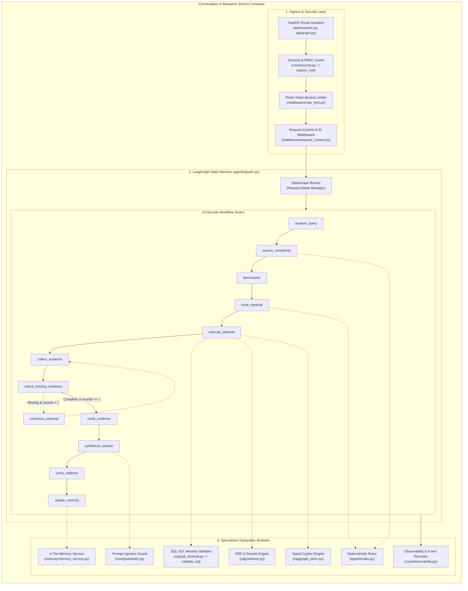
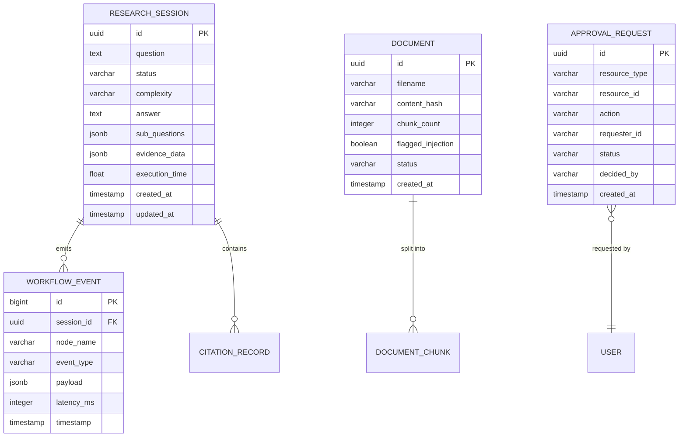
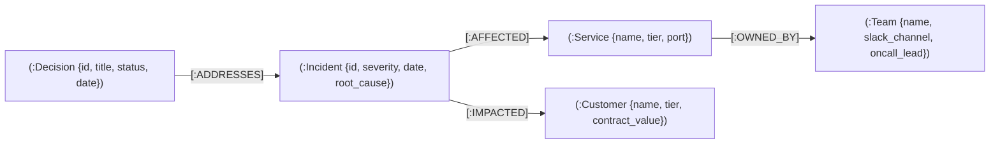
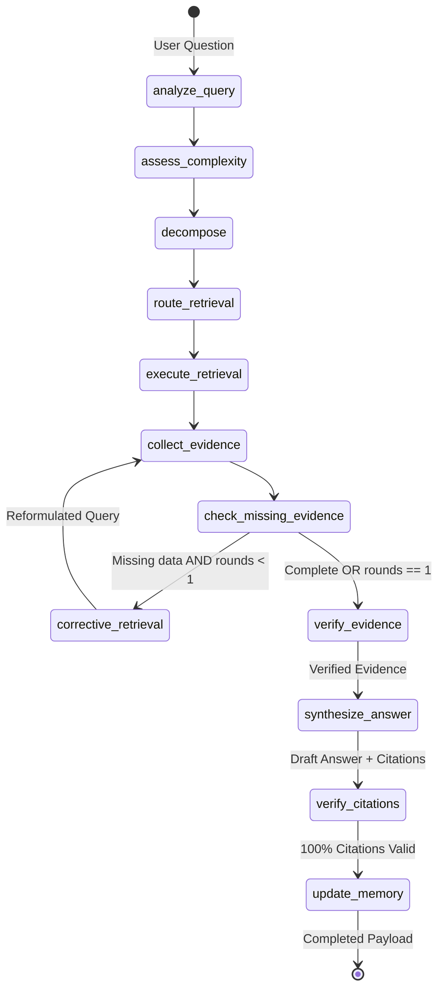

# Low-Level Design (LLD)
## NovaEnterprise — Enterprise Knowledge & Decision Intelligence Platform

> **Document Status:** Approved / Baseline  
> **Author:** Tech Lead & Principal Software Engineer  
> **Target Audience:** Backend Developers, AI/Agent Engineers, Frontend Engineers, QA Automation Leads, Code Reviewers  
> **Methodology Reference:** *The Complete AI Solution Architect Masterclass (NITMONK 2026)* — C3 Component Architecture & Concrete Code Contracts  
> **Upstream Documents:** [docs/BRD.md](BRD.md) · [docs/PRD.md](PRD.md) · [docs/FRD.md](FRD.md) · [docs/HLD.md](HLD.md)  
> **Authoritative Code Reference:** [Claude.md](../Claude.md) (Single Source of Truth) · [TASKS.md](../TASKS.md)

---

## 1. Component Architecture (C3 Level Decomposition)

Following **Slide 12 of the AI Solution Architect Masterclass**, the C3 view details the internal components within the primary application container (`FastAPI + LangGraph Service`), showing their precise responsibilities and data flow:



---

## 2. API Specifications & Data Contracts

All endpoints reside under `/api/v1` (with health endpoints at `/health` and `/health/ready`). All data payloads use strict **Pydantic v2** validation.

### 2.1 Research Execution Endpoints (`backend/app/api/research.py`)

#### `POST /api/v1/research` — Launch Research Job
- **Role Requirement:** `analyst` or `admin` (Viewer receives `403 Forbidden`).
- **Request Headers:**
  - `Authorization: Bearer <JWT>`
  - `X-Request-ID: <UUID4>` (optional; generated if absent)
- **Request Body (`ResearchCreateRequest`):**
  ```python
  class ResearchCreateRequest(BaseModel):
      question: str = Field(..., min_length=5, max_length=2000, description="Enterprise question in natural language")
      user_id: Optional[str] = Field(default="demo-user", description="Analyst identity for episodic memory")
  ```
- **Response Headers:** `X-Request-ID: <UUID4>`
- **Response Payload (`202 Accepted`):**
  ```json
  {
    "session_id": "f47ac10b-58cc-4372-a567-0e02b2c3d479",
    "status": "running",
    "question": "Which customers were impacted by the Payments API last quarter...",
    "created_at": "2026-11-27T12:00:00Z"
  }
  ```

#### `GET /api/v1/research/{session_id}` — Poll Research Session State
- **Role Requirement:** `viewer`, `analyst`, or `admin`.
- **Response Payload (`200 OK` — When Completed):**
  ```json
  {
    "session_id": "f47ac10b-58cc-4372-a567-0e02b2c3d479",
    "status": "completed",
    "complexity": "complex",
    "strategies_used": ["graph", "sql", "vector"],
    "corrective_rounds": 0,
    "verification_ratio": 1.0,
    "answer": "During Q2, three enterprise customers were impacted by the Payments API outage INC-2031 [1]: Acme Corp, TechFlow, and FinEdge. The service is owned by Payments Platform Team [2]...",
    "citations": [
      {
        "citation_id": 1,
        "evidence_id": "evi_01J8Z9X2...",
        "source_type": "graph",
        "locator": "(Service:Payments API)<-[:AFFECTED]-(Incident:INC-2031)-[:IMPACTED]->(Customer:Acme)",
        "snippet": "Acme Corp impacted by INC-2031"
      }
    ],
    "evidence": [
      {
        "id": "evi_01J8Z9X2...",
        "sub_question_id": "sq1",
        "source_type": "graph",
        "locator": "(Service:Payments API)<-[:AFFECTED]-(Incident:INC-2031)-[:IMPACTED]->(Customer:Acme)",
        "content": "Customer Acme Corp (tier: enterprise) was impacted by SEV1 outage INC-2031 on Payments API.",
        "score": 1.0,
        "metadata": { "store": "neo4j" }
      }
    ],
    "execution_time_seconds": 7.12
  }
  ```

#### `GET /api/v1/research/{session_id}/events` — Stream Workflow Telemetry
- **Response Payload (`200 OK`):**
  ```json
  [
    {
      "event_id": "evt_101",
      "session_id": "f47ac10b-58cc-4372-a567-0e02b2c3d479",
      "node_name": "assess_complexity",
      "event_type": "node_complete",
      "payload": { "complexity": "complex", "rule_applied": "RULE_CROSS_DOMAIN_JOIN" },
      "latency_ms": 142,
      "timestamp": "2026-11-27T12:00:01.142Z"
    }
  ]
  ```

---

## 3. Database Schema & Data Models (SQLAlchemy ORM)

### 3.1 Relational Schema (`backend/app/models/`)



### 3.2 Knowledge Graph Schema (Neo4j / In-Memory Graph)



---

## 4. Algorithms & Processing Logic

### 4.1 SQL Safety AST Validator (`rag/sql_retrieval.py -> validate_sql()`)
All queries synthesized by the SQL agent must satisfy strict AST validation before dispatch:

```python
import sqlglot
from sqlglot import exp

ALLOWLISTED_TABLES = {"incidents", "services", "teams", "customers", "decisions"}

def validate_sql(sql_str: str) -> bool:
    try:
        # Parse into Abstract Syntax Tree
        expressions = sqlglot.parse(sql_str, read="postgres")
        if not expressions or len(expressions) > 1:
            return False  # Disallow empty or multi-statement queries (semicolon injection)
        
        statement = expressions[0]
        
        # Enforce read-only SELECT
        if not isinstance(statement, exp.Select):
            return False
        
        # Validate all referenced tables exist in allowlist
        for table in statement.find_all(exp.Table):
            if table.name.lower() not in ALLOWLISTED_TABLES:
                return False
                
        # Prohibit destructive AST expressions
        disallowed = (exp.Drop, exp.Delete, exp.Insert, exp.Update, exp.AlterTable, exp.Command)
        if any(statement.find(node) for node in disallowed):
            return False
            
        return True
    except Exception:
        return False
```

---

### 4.2 Reciprocal Rank Fusion (RRF) & Cross-Encoder Reranker (`rag/retriever.py`)
Combines dense vector cosine similarity and sparse BM25 scores:

```python
def reciprocal_rank_fusion(
    vector_results: list[Chunk],
    bm25_results: list[Chunk],
    k: int = 60,
    top_n: int = 3
) -> list[Chunk]:
    scores: dict[str, float] = {}
    chunk_map: dict[str, Chunk] = {}

    for rank, chunk in enumerate(vector_results):
        scores[chunk.id] = scores.get(chunk.id, 0.0) + (1.0 / (k + (rank + 1)))
        chunk_map[chunk.id] = chunk

    for rank, chunk in enumerate(bm25_results):
        scores[chunk.id] = scores.get(chunk.id, 0.0) + (1.0 / (k + (rank + 1)))
        chunk_map[chunk.id] = chunk

    # Sort descending by fused score
    sorted_ids = sorted(scores.keys(), key=lambda cid: scores[cid], reverse=True)
    fused_candidates = [chunk_map[cid] for cid in sorted_ids[:10]]

    # Apply cross-encoder reranker
    return cross_encoder_rerank(fused_candidates, top_n=top_n)
```

---

### 4.3 Citation Verification & Integrity Algorithm (`agents/nodes/verify_citations.py`)
Guarantees that every synthesized citation token maps to an existing Evidence record:

```python
import re

def verify_citations_node(state: ResearchState) -> dict:
    answer_text = state.get("answer", "")
    evidence_list = state.get("evidence", [])
    
    # Extract all [n] integer citation tokens
    found_tokens = [int(m) for m in re.findall(r"\[(\d+)\]", answer_text)]
    valid_evidence_indices = set(range(1, len(evidence_list) + 1))
    
    unresolved = [tok for tok in found_tokens if tok not in valid_evidence_indices]
    
    # Strip or sanitize invalid tokens if any exist
    sanitized_answer = answer_text
    for bad_token in unresolved:
        sanitized_answer = sanitized_answer.replace(f"[{bad_token}]", "")
        
    return {
        "answer": sanitized_answer,
        "unresolved_citations": unresolved,
        "citations_verified": len(unresolved) == 0
    }
```

---

## 5. 13-Node LangGraph State Machine Specification



### Node Responsibility Matrix

| # | Node Name | Primary Responsibility | Input State Keys | Output State Keys |
|---|---|---|---|---|
| **1** | `analyze_query` | Extract intent, entity, and fiscal date bounds. | `question` | `intent`, `entity`, `time_range` |
| **2** | `assess_complexity` | Apply `rules.py` to classify simple/moderate/complex. | `intent`, `entity` | `complexity` |
| **3** | `decompose` | Split into focused sub-questions ($\le 4$). | `complexity`, `question` | `sub_questions` |
| **4** | `route_retrieval` | Assign `vector`, `sql`, `graph`, or `hybrid` per sub-question. | `sub_questions` | `sub_questions[strategy]` |
| **5** | `execute_retrieval` | Parallel store lookups adhering to protocol interfaces. | `sub_questions` | Raw store results |
| **6** | `collect_evidence` | Normalize records into uniform `Evidence` schema; deduplicate. | Raw store results | `evidence` |
| **7** | `check_missing_evidence` | Evaluate coverage of sub-questions; trigger corrective loop. | `evidence`, `sub_questions` | `missing_facets`, `needs_retry` |
| **8** | `corrective_retrieval` | Reformulate sub-queries with broadened search terms. | `missing_facets` | Reformulated sub-queries |
| **9** | `verify_evidence` | Cross-verify claims; compute factual consistency ratio. | `evidence` | `verified_evidence`, `ratio` |
| **10** | `synthesize_answer` | Generate grounded Markdown response with `[n]` citations. | `verified_evidence` | `answer` |
| **11** | `verify_citations` | Mathematical confirmation that all `[n]` map to valid evidence. | `answer`, `evidence` | `citations`, `verified_answer` |
| **12** | `update_memory` | Write episodic session context to Redis; update working scope. | `session_id`, `answer` | Memory state updated |

---

## 6. Error Handling, Retries & Timeouts

```text
┌────────────────────────────────────────────────────────────────────────┐
│                      TIMEOUT & RETRY SPECIFICATIONS                    │
├────────────────────┬──────────┬─────────┬──────────────────────────────┤
│ Subsystem Call     │ Timeout  │ Retries │ Fallback Behavior            │
├────────────────────┼──────────┼─────────┼──────────────────────────────┤
│ LLM Completion     │ 8.0 sec  │ 1 retry │ Switch to secondary provider │
│ (Model Gateway)    │          │ (backoff│ (e.g., Anthropic -> Gemini); │
│                    │          │  500ms) │ Offline: uses FakeProvider.  │
├────────────────────┼──────────┼─────────┼──────────────────────────────┤
│ SQL Query          │ 2.0 sec  │ 0 retry │ Catch timeout; record error; │
│ Execution          │          │         │ route to vector search.      │
├────────────────────┼──────────┼─────────┼──────────────────────────────┤
│ Neo4j Graph Bolt   │ 3.0 sec  │ 1 retry │ Degrade graph store; record  │
│ Traversal          │          │ (200ms) │ sub-question error in state. │
├────────────────────┼──────────┼─────────┼──────────────────────────────┤
│ Vector Search      │ 2.0 sec  │ 1 retry │ Fall back to BM25-only       │
│ (Qdrant)           │          │         │ sparse keyword retrieval.    │
└────────────────────┴──────────┴─────────┴──────────────────────────────┘
```

---

## 7. Configuration, Environment & Secrets Management

Configuration is centralized in `backend/app/core/config.py` using `pydantic-settings` with `@lru_cache`:

```python
class Settings(BaseSettings):
    PROJECT_NAME: str = "NovaEnterprise"
    API_V1_STR: str = "/api/v1"
    
    # Offline defaults
    LLM_PROVIDER: str = "fake"            # fake | openai | anthropic | gemini
    VECTOR_STORE: str = "memory"          # memory | qdrant
    GRAPH_STORE: str = "memory"           # memory | neo4j
    USE_FAKE_REDIS: bool = True           # true | false
    
    # Execution caps
    MAX_SUBQUESTIONS: int = 4
    MAX_CORRECTIVE_ROUNDS: int = 1
    RATE_LIMIT_PER_MINUTE: int = 120
    MAX_UPLOAD_MB: int = 5
    
    # Store credentials (Placeholders in .env.example)
    DATABASE_URL: str = "sqlite:///./data/enterprise.db"
    REDIS_URL: str = "redis://localhost:6379/0"
    QDRANT_URL: Optional[str] = None
    NEO4J_URI: Optional[str] = None
    NEO4J_USER: Optional[str] = None
    NEO4J_PASSWORD: Optional[str] = None

    class Config:
        env_file = ".env"
        case_sensitive = True
```

---

## 8. Logging, Metrics & Telemetry Specification

- **Structured JSON Logging:** Every log line is formatted as machine-readable JSON containing `timestamp`, `level`, `request_id`, `module`, and `message`.
- **Node Execution Spans:** Every LangGraph node is wrapped with `tracer.node(node_name)` emitting execution latency and input/output snapshots to `workflow_events`.
- **Privacy Filter:** All log formatters filter out raw LLM system instructions, proprietary templates, and unmasked customer credentials before stdout or DB write.

---

## 9. Unit & Integration Testing Strategy

The system enforces complete **offline-first test execution** (`make test`):

```bash
# Run complete test suite offline (Zero API Keys / Zero Network Calls)
make test
```

### Test Directory Topology (`tests/`):
- `tests/unit/`:
  - `test_sql_validator.py`: 8 unit tests proving `validate_sql()` blocks injection and allowlists tables.
  - `test_guardrails.py`: Proves hostile vendor notes are quarantined as data and flagged.
  - `test_rules.py`: Verifies deterministic complexity and routing floors.
- `tests/api/`:
  - `test_api.py`: Validates RBAC (Viewer gets 403), 202 research lifecycle, document upload validation, and approval gate.
  - `test_graph_endpoints.py`: Validates graph node browsing and expansion.
- `tests/rag/`:
  - `test_retrieval_graph.py`: Verifies hybrid RRF and typed Cypher traversals.
- `tests/agents/`:
  - `test_agents.py`: End-to-end execution of canonical multi-store question, simple question, and bounded corrective retrieval.
- `tests/evaluation/`:
  - `evaluate.py`: Scores the 6 CI threshold metrics against `tests/evaluation/datasets/eval_cases.json`.

---
*End of Document Chain:* **[docs/BRD.md](BRD.md)** → **[docs/PRD.md](PRD.md)** → **[docs/FRD.md](FRD.md)** → **[docs/HLD.md](HLD.md)** → **[docs/LLD.md](LLD.md)**
