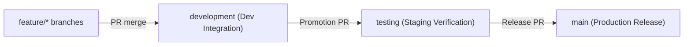

# NovaEnterprise — Production Deployment Runbook (P14-5)

> Document Reference: `docs/runbooks/01_DEPLOYMENT_RUNBOOK.md`  
> Authoritative Specifications: `Claude.md §14, §15` · `Git_GitHub_Workflow_Guide.md`  

---

## 1. Scope & Release Lifecycle

This runbook defines the formal release and deployment operations for the **NovaEnterprise Knowledge & Decision Intelligence Platform**.

### 1.1 Promotion Workflow
Code promotes strictly through three canonical long-lived branches:


1. **`development`:** Continuous integration branch for validated feature pull requests.
2. **`testing`:** Staging environment where full offline suites, evaluation harnesses, and multi-service smoke tests run.
3. **`main`:** Production branch. Images deployed to production must always be tagged with the exact **Git SHA** (`Claude.md §15.1`).

---

## 2. Pre-Deployment Verification Checklist

Before initiating any deployment or merging a promotion PR, the Release Owner must verify:
- [ ] **Test Gate:** `make test` passes 100% offline (468+ tests).
- [ ] **Evaluation Gate:** `make eval` passes all 6 CI threshold metrics with 1.00 score.
- [ ] **Linter & Types:** `ruff check` passes with 0 warnings; `mypy` passes with 0 errors across all source files.
- [ ] **Frontend Health:** `cd frontend && npm test && npm run type-check` passes with 0 errors.
- [ ] **Compose Syntax:** `docker-compose config -q` passes cleanly.
- [ ] **Secret Hygiene:** Zero unencrypted secrets, `.env` files, or local database caches staged.

---

## 3. Production Deployment Procedures

### 3.1 Docker Compose Deployment
For on-premise or single-host VM deployments:

```bash
# 1. Clone or fetch verified release tag / main branch
git fetch origin main && git checkout main

# 2. Configure environment credentials
cp .env.docker.example .env.docker
# Edit .env.docker with production secrets (PostgreSQL password, Neo4j auth, JWT secret)
chmod 600 .env.docker

# 3. Pull or build container images with Git SHA
export GIT_SHA=$(git rev-parse HEAD)
docker compose --env-file .env.docker build

# 4. Launch backing stores first
docker compose --env-file .env.docker up -d postgres redis qdrant neo4j

# 5. Run database schema migrations
docker compose --env-file .env.docker exec -T backend alembic upgrade head

# 6. Launch application server and frontend console
docker compose --env-file .env.docker up -d backend frontend

# 7. Check container runtime status
docker compose --env-file .env.docker ps
```

### 3.2 Cloud Architecture (Kubernetes / AWS ECS)
In managed cloud deployments:
- **Relational SQL:** AWS Aurora PostgreSQL / Supabase
- **Vector Engine:** Qdrant Cloud cluster
- **Knowledge Graph:** Neo4j AuraDB Enterprise
- **Cache & Throttling:** AWS ElastiCache for Redis
- **Compute:** ECS Fargate / EKS running `backend` and `frontend` pods

---

## 4. Post-Deployment Smoke Testing & Readiness Verification

Once containers are launched, execute the verification suite:

```bash
# 1. Liveness check
curl -f http://localhost:8001/health/live
# Expected: {"status": "ok"}

# 2. Readiness check (Must verify all 5 adapters)
curl -s http://localhost:8001/health/ready | python3 -m json.tool
# Expected output under real services:
# {
#   "status": "ready",
#   "checks": {
#     "database": {"status": "ok", "detail": "database: postgresql://..."},
#     "redis": {"status": "ok", "detail": "redis: redis://..."},
#     "vector_store": {"status": "ok", "detail": "qdrant http://qdrant:6333"},
#     "graph_store": {"status": "ok", "detail": "neo4j bolt://neo4j:7687"},
#     "llm": {"status": "ok", "detail": {"llm_provider": "..."}}
#   }
# }

# 3. Frontend connectivity
curl -I http://localhost:3001/
# Expected: HTTP 200 OK
```

---

## 5. Rollback Playbook

If readiness checks report `degraded` or unexpected errors occur:

1. **Immediate Service Rollback:**
   ```bash
   # Roll back to previous Git SHA tag
   git checkout <PREVIOUS_STABLE_GIT_SHA>
   docker compose --env-file .env.docker up -d --build
   ```
2. **Database Rollback:**
   ```bash
   # If schema migration introduced breaking issues:
   docker compose --env-file .env.docker exec backend alembic downgrade -1
   ```
3. **Cache Flush:**
   ```bash
   docker compose --env-file .env.docker exec redis redis-cli FLUSHDB
   ```
4. **Traffic Verification:**
   Re-verify `/health/ready` to ensure system returns to `ready` status.
